# Not Obvious

**See what every AI would say. Then go somewhere else.**

Not Obvious is an open-source MCP server against banality. Before it gives you ideas, it shows you the *cliché cloud*: the answers that every large language model gives to your exact question. Then it pushes away from that cloud with real creativity techniques (SCAMPER, TRIZ, morphological matrix, far analogies, constraint flips), crosses ideas (remix A x B), and **measures** how far each idea actually got with a Cliché Score.

> "Your idea is 82% cliché. Here's the AI answer it's closest to."



## Why

LLMs converge. Ask five models for a side business and you get five versions of "start a SaaS, freelance, make a course". Research calls this the [Artificial Hivemind](https://arxiv.org/abs/2510.22954). Existing creativity MCP servers wrap techniques in prompts and let the model grade itself. Not Obvious builds the cloud of typical answers per prompt and scores ideas by semantic distance from it, so originality is measured, not self-reported.

## When to use it

When the first answer is not enough: naming, positioning, a side project, a talk topic, a campaign, a research angle. Anywhere the obvious answer is the one your competitors, classmates or colleagues already got from the same chatbot. Ask your assistant to run `baseline` first and you see the answers to avoid; `diverge` gives you ideas that are measurably outside them; `score` and `explain` tell you whether your own idea is one of the clichés and how to move it. Put a few sentences about yourself into the prompt (where you live, what you have, what you can't do): our [context experiment](docs/context.md) shows that alone moves answers 12-25 points away from the crowd, and Not Obvious then builds the cloud for *that* prompt and pushes further.

## Tools

| Tool | What it does |
|---|---|
| `baseline` | Asks every configured model the plain question and returns the cliché cloud (cached per prompt). |
| `diverge` | Generates ideas away from the cloud with a named technique (`scamper`, `triz`, `morphological`, `far-analogy`, `constraint-flip`) or `all` five in parallel. Keeps only ideas with an embedding Cliché Score below 50 and usefulness 6+; if too few survive, it regenerates with the rejection reasons. Survivors are then searched on the web, their score gets the web part, and ones that already exist as a common product or practice are flagged `existsOnline` and sorted last. Returns the survivors and the closest misses. |
| `remix` | Crosses idea A and idea B into hybrids that neither parent nor the cloud contains. Scores the parents first, takes at least one component (mechanism, audience, channel, constraint) from each and flags which hybrids escaped the cloud. |
| `score` | Cliché Score 0-100 for any list of ideas (0 = far from the AI consensus and from what already exists), with its parts: embedding distance, web prevalence 0-10 with sources, the mechanism judge verdict (closest cliché and why), plus a usefulness critic 1-10. `web: false` skips the search and returns the embedding part alone. |
| `explain` | Why an idea scored the way it did, one concrete move to push it further, and the idea rewritten with that move and re-scored (e.g. "programming course for beginners" 88% -> "coding escape-room kits for libraries and team events" 45%). |

## Cliché Score (v0.3)

1. Build the cloud: each model answers the plain prompt; answers are embedded and near-duplicates merged.
2. Embed the idea and find its nearest cliché.
3. Normalise against the cloud's own density: an idea as close to the cloud as clichés are to each other scores about 100; the scale adapts to how tight the cloud is (spread = 0.4 x (1 - density)).
4. Web check: the idea is searched on the web (Claude web search, or Brave Search with `BRAVE_API_KEY`) and rated 0-10 for how much of it already exists, with sources. Final score: 60% embedding distance + 40% web prevalence. Without a web check the score is the embedding part alone.
5. A mechanism judge (a fast LLM) says which cliché the idea is closest to and how much of its mechanism it shares (0-10, with a reason). It explains the score but is not blended in: it did not improve held-out accuracy.
6. A separate critic rates usefulness so that "far away" never means "nonsense".

Calibrated on 270 labelled ideas for 20 prompts: 70 hand-written anchors and 200 generated ideas rated blind by three LLM judges ([`docs/scoring.md`](docs/scoring.md)). With leave-one-prompt-out cross-validation a more clichéd idea outranks a less clichéd one in 86% of pairs (82% with embeddings alone), and the score agrees with the judges' originality ratings at Spearman 0.73. Human ratings are on the roadmap. The formula lives in [`src/math.ts`](src/math.ts).

## Quick start

```json
{
  "mcpServers": {
    "not-obvious": {
      "command": "npx",
      "args": ["-y", "not-obvious-mcp"],
      "env": { "ANTHROPIC_API_KEY": "...", "GEMINI_API_KEY": "..." }
    }
  }
}
```

One key is enough; two model families give a better cloud. With Claude every model reply is constrained by a JSON schema (structured outputs); Gemini gets the same schema as `responseJsonSchema`. Web checks use Claude web search when `ANTHROPIC_API_KEY` is set (about $0.01 per idea), otherwise Brave Search with `BRAVE_API_KEY`; `NOT_OBVIOUS_WEB=off` disables them. Without a Gemini key, embeddings fall back to an offline lexical mode (works, but less semantic).

CLI for quick checks:

```bash
npx -p not-obvious-mcp not-obvious baseline "Suggest a side business for a software developer"
npx -p not-obvious-mcp not-obvious score "Suggest a side business for a software developer" "Build a SaaS for small businesses"
npx -p not-obvious-mcp not-obvious diverge "Suggest a side business for a software developer" all
npx -p not-obvious-mcp not-obvious explain "Suggest a side business for a software developer" "Write a programming course for beginners"
```

## Which model is the most banal?

We asked 11 models from Anthropic, Google and Sber the same 30 open prompts (5 answers each) and scored every model against the answers of the other vendors. Full table, method and caveats: [docs/leaderboard.md](docs/leaderboard.md).

| model | banality, 0-100 | ideas another vendor also gave |
|---|---|---|
| claude-haiku-4-5 | 93.5 | 70% |
| gemini-3.8-flash | 93.2 | 73% |
| claude-opus-5-5 | 91.8 | 76% |
| GigaChat-2 | 86.0 | 55% |

They all say the same thing: 81-92% of each model's answers are practically an answer some other vendor gave, and the intervals overlap. Asked to name a black cat, 9 of 11 models say Midnight. Bigger and newer models are not less banal.

What does help is context about the person asking. With two sentences about who they are, banality drops by 12-25 points for every model we tried. But give the same person to three models and they agree with each other again (80-91): the crowd moves to a new spot instead of disappearing. Details: [docs/context.md](docs/context.md).

## Roadmap

- [x] Web novelty: is the idea already out there (web search, prevalence 0-10 with sources)
- [ ] More models in the cloud (OpenRouter), local embeddings
- [x] Public leaderboard: which model is the most banal ([docs/leaderboard.md](docs/leaderboard.md))
- [ ] Calibration set with human originality ratings

## Prior work

[Artificial Hivemind](https://arxiv.org/abs/2510.22954) (cross-model homogeneity), [NoveltyBench](https://novelty-bench.github.io) (within-model diversity), [Creativity Index](https://arxiv.org/abs/2410.04265) (novelty vs. web text), [novelty as distance from reference ideas](https://arxiv.org/abs/2504.09389). Not Obvious packages these ideas into a per-prompt, interactive tool.

## License

MIT
